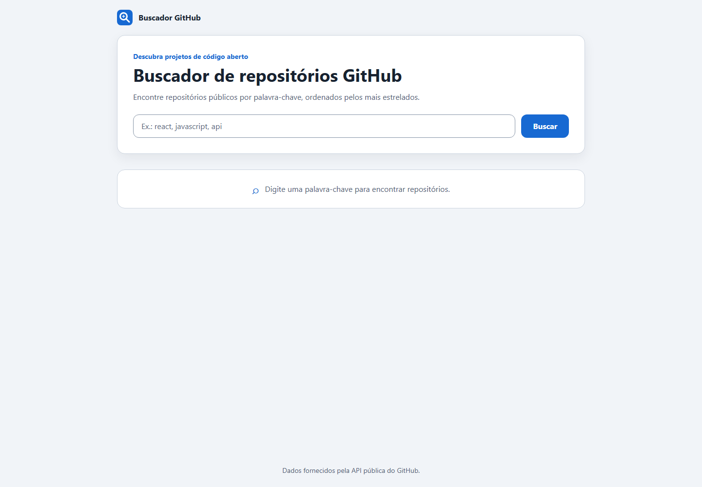

# Buscador de repositórios GitHub

## Apresentação do projeto

O Buscador GitHub é uma aplicação web para encontrar repositórios públicos do GitHub por palavra-chave. Os resultados são ordenados pelo número de estrelas e exibidos em cartões com informações do repositório e de seu autor.



## Como executar

Não é necessário instalar dependências, configurar um servidor ou compilar o projeto.

1. Clone o repositório e acesse a pasta:

   ```bash
   git clone https://github.com/Thalesffdev/buscador_repo.git
   cd buscador_repo
   ```

2. Abra `index.html` em um navegador atualizado.
3. Digite uma palavra-chave e pressione **Enter** ou clique em **Buscar**.

É necessária uma conexão com a internet para consultar a API pública do GitHub. Também é possível usar a extensão Live Server do VS Code para abrir a aplicação em um servidor local.

## Stack do projeto

O projeto é uma aplicação estática executada no navegador. A interface e a lógica são implementadas sem frameworks, bibliotecas externas, backend ou etapa de build.

```text
index.html       Estrutura da página
css/style.css    Aparência e layout responsivo
js/main.js       Busca na API e comportamento da interface
assets/          Imagem de prévia e favicon
```

## Tecnologias

- **HTML5** para a estrutura semântica, formulários e elementos acessíveis.
- **CSS3** para estilos, variáveis visuais, Flexbox, Grid e adaptação a diferentes telas.
- **JavaScript puro (ES6+)** para eventos, validação, requisições assíncronas e atualização dos resultados.
- **GitHub REST API**, endpoint de busca de repositórios, como fonte dos dados.

## Recursos

- Busca de até 10 repositórios públicos por palavra-chave, ordenados por estrelas.
- Cartões com avatar e nome do autor, nome e descrição do repositório, linguagem, estrelas e link para o GitHub.
- Formatação de números conforme a localidade `pt-BR` e textos alternativos quando descrição ou linguagem não estão disponíveis.
- Estados de início, carregamento, resultados encontrados, busca sem resultados, erro e validação de campo vazio.
- Opção para repetir uma busca após uma falha e botão para voltar ao topo da página.
- Layout responsivo, navegação por teclado, foco visível e mensagens de estado anunciadas a tecnologias assistivas.
- Respeito à preferência do sistema por movimento reduzido e uso de links externos com proteção contra acesso à página de origem.

## Como o código funciona

### HTML

O `index.html` define a página em português, seus metadados, cabeçalho, formulário de busca, área de resultados e rodapé. Os elementos que o JavaScript atualiza possuem identificadores, como `formulario-busca`, `estado-carregamento` e `lista-repositorios`. O script é carregado com `defer`, portanto a estrutura HTML é interpretada antes da execução do JavaScript.

### CSS

O `css/style.css` controla cores, tipografia, espaçamentos e componentes usando variáveis CSS. O layout começa em uma coluna e se adapta em telas maiores: o formulário fica lado a lado a partir de 600 px e os cartões de resultado formam duas colunas a partir de 900 px. Os estilos também destacam foco e estados de interação; animações e transições são reduzidas quando o usuário prefere movimento reduzido.

### JavaScript

O `js/main.js` coordena o fluxo da aplicação:

1. Seleciona os elementos da página e registra os eventos do formulário, do campo, do botão de nova tentativa, da rolagem e do botão de voltar ao topo. O envio pelo formulário atende tanto ao clique em **Buscar** quanto à tecla **Enter**.
2. Ao receber o envio, impede a navegação padrão, remove espaços extras do termo e valida se ele não está vazio. Se estiver vazio, exibe uma mensagem junto ao campo e devolve o foco para ele.
3. Codifica o termo com `encodeURIComponent()` e monta uma consulta à API com ordenação por estrelas e limite de 10 resultados.
4. Antes de iniciar a busca, cancela uma requisição anterior, se houver. Usa `fetch()` com `async`/`await`, o cabeçalho `Accept` esperado pela API e um `AbortController` para controlar o cancelamento.
5. Durante a consulta, mostra o carregamento, limpa os resultados anteriores e desabilita o campo e o botão. Ao final da requisição ativa, restaura os controles, inclusive em caso de erro.
6. Interpreta a resposta: sem itens, mostra o estado vazio; com itens, monta os cartões e o contador de resultados. Cada elemento é criado com `createElement()` e recebe conteúdo textual por `textContent`, sem inserir dados da API com `innerHTML`.
7. Converte falhas de rede e respostas HTTP em mensagens apropriadas, incluindo limite de requisições e instabilidade do GitHub. Após um erro, a opção de nova tentativa refaz a última busca.
8. Valida URLs externas para aceitar apenas HTTPS e abre links de repositórios em uma nova aba com `rel="noopener noreferrer"`. Avatares indisponíveis são removidos sem interromper os resultados.

## Publicação

A aplicação pode ser hospedada em qualquer serviço de hospedagem estática, sem configuração de build. Para publicar no GitHub Pages:

1. Envie os arquivos do projeto para o repositório no GitHub.
2. Abra **Settings → Pages** no repositório.
3. Em **Build and deployment**, escolha a publicação a partir de uma branch e selecione a branch desejada e a pasta raiz (`/`).
4. Salve e aguarde a geração do endereço indicado pelo GitHub Pages.

Após a publicação, teste a página e os caminhos dos arquivos estáticos. Se for configurado um domínio ou endereço canônico, atualize também os metadados de compartilhamento no `index.html` (`canonical`, `og:url` e `og:image`) com as URLs públicas correspondentes. A busca depende da disponibilidade e dos limites de uso da API do GitHub.
