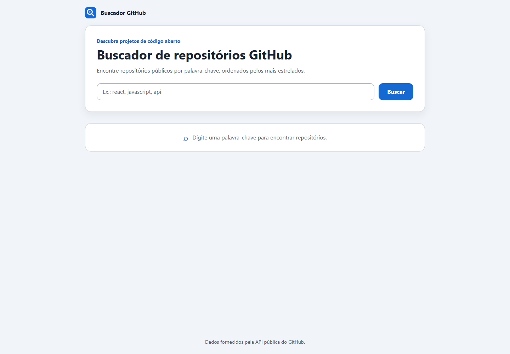

# Buscador de repositórios GitHub

Aplicação web para pesquisar repositórios públicos do GitHub por palavra-chave. Os resultados são ordenados por estrelas e apresentados em cartões responsivos com informações do projeto e de seu autor.

## Prévia

Abra `index.html` no navegador para fazer uma busca. Uma conexão com a internet é necessária para consultar a API do GitHub.

## Como executar

1. Baixe ou clone este repositório.
2. Abra `index.html` diretamente em um navegador atualizado.
3. Digite um termo e pressione **Enter** ou clique em **Buscar**.

Não é necessário instalar dependências, configurar um servidor ou executar uma etapa de compilação.

## Tecnologias

- HTML semântico
- CSS responsivo
- JavaScript puro
- API pública de busca de repositórios do GitHub

## Recursos

- Busca de até 10 repositórios, ordenados por estrelas.
- Estados de carregamento, resultados vazios e mensagens de erro com opção para tentar novamente.
- Validação do termo, cancelamento de requisições anteriores e renderização segura dos dados.
- Acessibilidade por teclado, anúncios de estado para leitores de tela e suporte a movimento reduzido.

## Publicação

O projeto pode ser publicado em hospedagem estática, como GitHub Pages. Depois de definir o endereço público, adicione a URL canônica e os endereços absolutos `og:url` e `og:image` no `index.html`.
